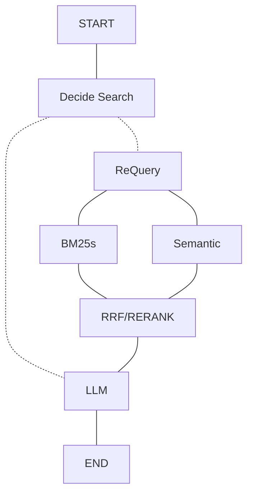

# FastRag
Fast Rag

## 配置

所有参数集中在 `config/fastrag.toml`：`[paths]`、`[api]`、`[chunking]`、
`[embedding]`、`[llm]`、`[reranker]`、`[bm25]`、`[retrieval]`、`[fusion]`。
API key 只从 `.env` 读取（默认变量名 `SILICONFLOW_API_KEY`，见 `.env.example`）。

- `retrieval.candidates`：BM25 / 向量两路各召回多少条
- `retrieval.top_n`：最终送入 LLM 的片段数，也是各命令行工具的默认返回条数
- `fusion.method`：`rrf`（默认）或 `rerank`
- `fusion.rrf_k`：RRF 平滑常数，避免与 `top_n` 混淆

