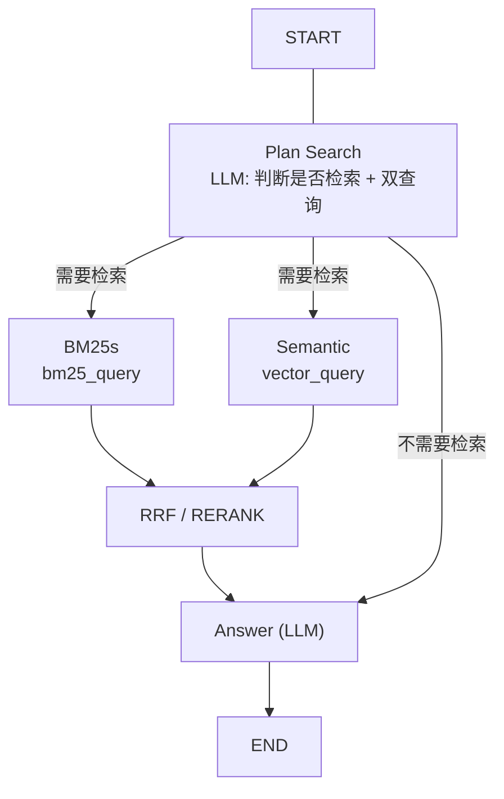

# FastRag
Fast Rag

## 安装与运行

```bash
uv sync                      # 开发环境（editable，源码改动立即生效）
uv run fastrag --help
```

也可以构建 wheel 后安装，安装完不依赖源码树（配置与提示词随包分发）：

```bash
uv build
uv pip install dist/fastrag-0.1.0-py3-none-any.whl
fastrag --help
```

`python -m fastrag.<模块>` 仍然可用，等价于对应的子命令。

## 命令行

| 子命令 | 作用 |
| --- | --- |
| `fastrag download` | 下载示例文档到 `data/langchain-docs` |
| `fastrag chunk` | 切块，生成 `data/chunks.jsonl` |
| `fastrag embed` | 生成/复用向量，写入 `data/embeddings` |
| `fastrag index` | 构建 BM25 索引 |
| `fastrag prepare` | 依次跑 chunk → embed → index |
| `fastrag search "..." -k N` | BM25 关键词检索 |
| `fastrag rerank "..." -n N` | 对 BM25 候选做重排 |
| `fastrag rrf "..." -n N` | 融合 BM25 与向量两路排名 |
| `fastrag ask` | 交互式问答 |

子命令的其余参数会透传给对应模块，例如 `fastrag search --help`。

## 构建数据

一条命令刷新全部产物（切块 → 向量 → BM25 索引）：

```bash
uv run fastrag prepare
```

三份产物用 `chunks.jsonl` 的 sha256 互相校验：语料变化后向量会自动重建；
BM25 索引检测到语料或 `[bm25]` 参数变化时会以报错提示重建，
`prepare` 会把三步一起跑完，避免手工漏步。

## 本地模型

包内 `fastrag.local.toml` 是全本地链路示例：bge-m3 嵌入（1024 维）+ qwen3-4b-instruct
做检索规划与回答，默认指向本机 llama.cpp（`127.0.0.1:9931` / `9938`）：

```bash
uv run fastrag --config local prepare   # 切块 → 向量 → BM25 索引
uv run fastrag --config local ask       # 交互式问答
```

`--config` 既接受包内配置名（`default` / `local`），也接受任意配置文件路径。

本地服务不校验 key 时，`[endpoints.*].api_key_env` 留空即可。若本机设置了 SOCKS 代理，
需要 `NO_PROXY=127.0.0.1,localhost` 才能访问本地端口。

## 配置

默认配置随包分发（`fastrag.resources/config/fastrag.toml`）。想修改时，把配置放到
`$FASTRAG_HOME/config/fastrag.toml`（默认 `FASTRAG_HOME` 为源码树根目录；安装 wheel 后为当前目录），
或用 `FASTRAG_CONFIG` / `--config` 指向其他文件。配置里的相对路径、`.env` 都在
`FASTRAG_HOME` 下解析。

所有参数集中在同一个 TOML：`[paths]`、`[endpoints.*]`、`[chunking]`、
`[embedding]`、`[llm.route]`、`[llm.answer]`、`[reranker]`、
`[bm25]`、`[retrieval]`、`[fusion]`。

API key 从 `.env` / 环境变量读取；每个 endpoint 用 `api_key_env` 指定自己的变量名
（默认 `SILICONFLOW_API_KEY`，见 `.env.example`），本地服务留空即可。

- `[endpoints.*]`：厂家接入信息（`base_url` + `api_key_env`），嵌入、重排、各 LLM 角色都可引用不同厂家
- `[llm.route]` / `[llm.answer]`：`plan_search`（判断是否检索 + 生成两路查询）与生成回答可分别配置模型、厂家与温度；`thinking = false` 关闭推理模型的思考；`timeout` 是单次请求超时（秒）
- `[llm.*].retries`：直接作为客户端 SDK 的 `max_retries`（只对超时/限流/5xx 等瞬时错误做指数退避，实际请求次数为 `1 + retries`）
- `[llm.*.fallback]`：重试耗尽后使用的备用模型，可继续嵌套 `fallback` 形成多级兜底（默认配置里回答备用模型指向本地 llama.cpp）
- `api_key_env` 留空的 endpoint 视为本地服务，客户端用占位 key，不需要 `.env`
- `[bm25]`：停用词、打分方法与 `min_score`；默认过滤掉分数不大于 0 的命中
- 提示词：包内 `fastrag.resources/prompts/`，可在 `$FASTRAG_HOME/prompts/` 放同名文件覆盖
  - `search_plan.txt`：一次 LLM 调用同时判断是否检索并生成两条英文查询
  - `answer.txt` / `chat.txt`：需要检索时按资料作答，不需要检索时直接回答（寒暄类问题不会回「资料不足」）
- `retrieval.bm25_candidates` / `retrieval.vector_candidates`：BM25 与向量两路各自的召回条数
- `retrieval.top_n`：最终送入 LLM 的片段数，也是各命令行工具的默认返回条数
- `fusion.method`：`rrf`（默认）或 `rerank`
- `fusion.weights`：两路权重，默认 BM25 略高
- `fusion.rrf_k`：RRF 平滑常数，避免与 `top_n` 混淆


