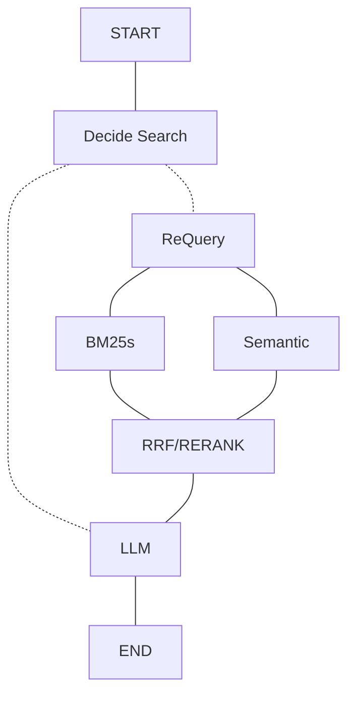

# FastRag
Fast Rag

## 配置

所有参数集中在 `config/fastrag.toml`：`[paths]`、`[endpoints.*]`、`[chunking]`、
`[embedding]`、`[llm.route]`、`[llm.requery]`、`[llm.answer]`、`[reranker]`、
`[bm25]`、`[retrieval]`、`[fusion]`。
API key 只从 `.env` 读取；每个 endpoint 用 `api_key_env` 指定自己的变量名
（默认 `SILICONFLOW_API_KEY`，见 `.env.example`）。

- `[endpoints.*]`：厂家接入信息（`base_url` + `api_key_env`），嵌入、重排、各 LLM 角色都可引用不同厂家
- `[llm.route]` / `[llm.requery]` / `[llm.answer]`：路由、问题重写、生成三个角色可分别配置模型、厂家与温度
- `retrieval.bm25_candidates` / `retrieval.vector_candidates`：BM25 与向量两路各自的召回条数
- `retrieval.top_n`：最终送入 LLM 的片段数，也是各命令行工具的默认返回条数
- `fusion.method`：`rrf`（默认）或 `rerank`
- `fusion.weights`：两路权重，默认 BM25 略高
- `fusion.rrf_k`：RRF 平滑常数，避免与 `top_n` 混淆

