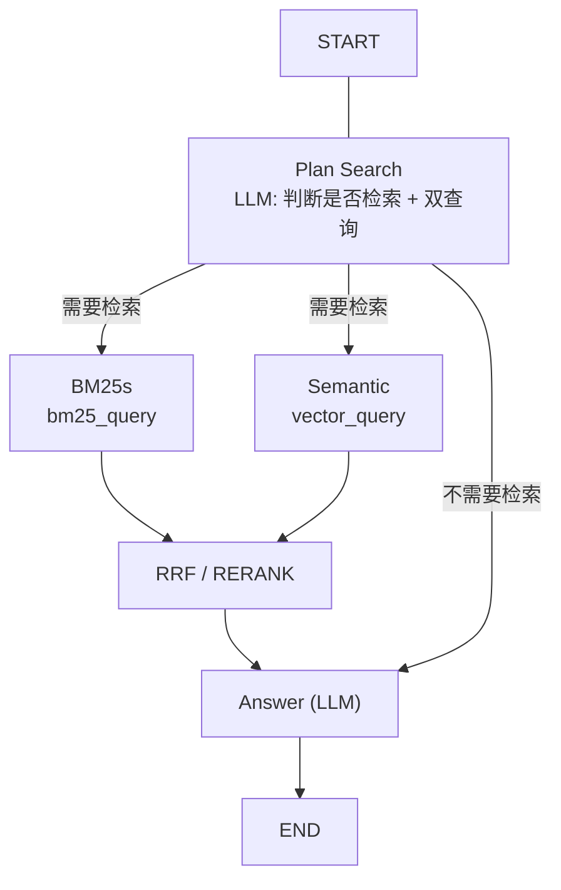

# FastRag
Fast Rag

## 构建数据

一条命令刷新全部产物（切块 → 向量 → BM25 索引）：

```bash
uv run python -m fastrag.prepare
```

三份产物用 `chunks.jsonl` 的 sha256 互相校验：语料变化后向量会自动重建；
BM25 索引检测到语料或 `[bm25]` 参数变化时会报错并要求重建，
`prepare` 会把三步一起跑完，避免手工漏步。

## 本地模型

`config/fastrag.local.toml` 是全本地链路示例：bge-m3 嵌入（1024 维）+ qwen3-4b-instruct
做检索规划与回答，默认指向本机 llama.cpp（`127.0.0.1:9931` / `9938`）。无需复制覆盖默认配置：

```bash
export FASTRAG_CONFIG=config/fastrag.local.toml
uv run python -m fastrag.prepare        # 切块 → 向量 → BM25 索引
uv run python -m fastrag.rag_graph      # 交互式问答
```

本地服务不校验 key 时，`[endpoints.*].api_key_env` 留空即可。若本机设置了 SOCKS 代理，
需要 `NO_PROXY=127.0.0.1,localhost` 才能访问本地端口。

## 配置

所有参数集中在 `config/fastrag.toml`：`[paths]`、`[endpoints.*]`、`[chunking]`、
`[embedding]`、`[llm.route]`、`[llm.answer]`、`[reranker]`、
`[bm25]`、`[retrieval]`、`[fusion]`。
API key 从 `.env` / 环境变量读取；每个 endpoint 用 `api_key_env` 指定自己的变量名
（默认 `SILICONFLOW_API_KEY`，见 `.env.example`），本地服务留空即可。

- `[endpoints.*]`：厂家接入信息（`base_url` + `api_key_env`），嵌入、重排、各 LLM 角色都可引用不同厂家
- `[llm.route]` / `[llm.answer]`：`plan_search`（判断是否检索 + 生成两路查询）与生成回答可分别配置模型、厂家与温度；`thinking = false` 关闭推理模型的思考
- `api_key_env` 留空的 endpoint 视为本地服务，客户端用占位 key，不需要 `.env`
- `FASTRAG_CONFIG` 可指定其他配置文件（默认 `config/fastrag.toml`），全本地示例见 `config/fastrag.local.toml`
- `[bm25]`：停用词、打分方法与 `min_score`；默认过滤掉分数不大于 0 的命中
- `prompts/search_plan.txt`：一次 LLM 调用同时判断是否检索并生成两条英文查询；`bm25_query` 用术语叠加，`vector_query` 用自然语言问句
- `prompts/answer.txt` / `prompts/chat.txt`：需要检索时按资料作答，不需要检索时直接回答（寒暄类问题不会回「资料不足」）
- `retrieval.bm25_candidates` / `retrieval.vector_candidates`：BM25 与向量两路各自的召回条数
- `retrieval.top_n`：最终送入 LLM 的片段数，也是各命令行工具的默认返回条数
- `fusion.method`：`rrf`（默认）或 `rerank`
- `fusion.weights`：两路权重，默认 BM25 略高
- `fusion.rrf_k`：RRF 平滑常数，避免与 `top_n` 混淆


