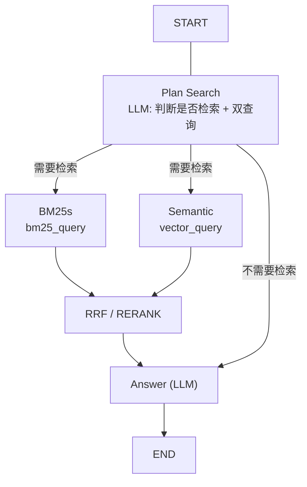

# FastRag

本地文档混合检索（BM25 + 向量）问答。切块、索引、召回、融合与生成全部可配置，
嵌入 / 重排 / LLM 可以分别指向不同厂家或本地服务。

## 安装与运行

```bash
uv sync
fastrag --help
python -m fastrag --help      # 等价入口
```

构建 wheel 后安装不依赖源码树（配置与提示词随包分发）：

```bash
uv build
uv pip install dist/fastrag-0.2.0-py3-none-any.whl
```

## 命令行

| 子命令 | 作用 |
| --- | --- |
| `fastrag download` | 下载示例文档到 `data/langchain-docs` |
| `fastrag chunk` | 切块，生成 `data/chunks.jsonl` |
| `fastrag embed [--query Q]` | 生成/复用向量，写入 `data/embeddings` |
| `fastrag index` | 构建 BM25 索引 |
| `fastrag prepare` | 依次跑 chunk → embed → index |
| `fastrag search "..." -k N` | BM25 关键词检索 |
| `fastrag rerank "..." -n N` | 对 BM25 候选做重排 |
| `fastrag rrf "..." -n N` | 融合 BM25 与向量两路排名 |
| `fastrag ask` | 交互式问答 |

全局选项 `--config`、`-v/--verbose`、`--version` 可放在子命令前后任意位置：

```bash
fastrag --config local prepare
fastrag ask --config local -v
```

## 构建数据

```bash
uv run fastrag prepare
```

三份产物用 `chunks.jsonl` 的全字节 sha256 互相校验：

- 向量按 chunk id 增量复用：只嵌入新增或内容变化的块；
- BM25 索引检测到语料或 `[bm25]` 参数变化时提示重建；
- 写向量与 manifest 都采用「临时文件 + 原子 rename」。

## 库调用

```python
from fastrag import ask, prepare, RagPipeline

prepare()  # 切块 -> 向量 -> BM25 索引

result = ask("LangGraph 里怎么实现 human-in-the-loop？")
print(result.answer)
for item in result.sources:
    print(item.chunk.source, item.score)

# 同一进程可以为不同配置各建一个实例，互不干扰
pipeline = RagPipeline.from_config()
for event in pipeline.stream("..."):
    if event.kind == "token":
        print(event.text, end="")
    else:
        print(event.result.sources)
```

`import fastrag` 本身不读 `.env`、不联网、不打印；资源在第一次检索时才懒加载，
寒暄类问题（`need_search=False`）不会触发嵌入或索引加载。

## 本地模型

包内 `fastrag.local.toml` 是全本地链路示例：bge-m3 嵌入（1024 维）+ qwen3-4b-instruct
做检索规划与回答，默认指向本机 llama.cpp（`127.0.0.1:9931` / `9938`）：

```bash
uv run fastrag --config local prepare
uv run fastrag --config local ask
```

`--config` 既接受包内配置名（`default` / `local`），也接受任意配置文件路径。

## 配置

默认配置随包分发（`fastrag.resources/config/fastrag.toml`）。想修改时，把配置放到
`$FASTRAG_HOME/config/fastrag.toml`（默认 `FASTRAG_HOME` 为源码树根目录；安装 wheel 后为当前目录），
或用 `FASTRAG_CONFIG` / `--config` 指向其他文件。配置里的相对路径、`.env` 都在
`FASTRAG_HOME` 下解析。

配置使用 pydantic 严格校验：未知键（例如把 `[retrieval]` 拼成 `[retrival]`）、
非法数值、引用不存在的 endpoint 都会在加载期报错，而不是静默使用默认值。

所有参数集中在同一个 TOML：

| 配置节 | 说明 |
| --- | --- |
| `[paths]` | 文档、chunk、向量、BM25 索引的位置 |
| `[endpoints.*]` | 厂家接入信息（`base_url` + `api_key_env`），留空表示本地服务 |
| `[chunking]` | tokenizer、块大小、重叠与模板头正则 |
| `[embedding]` | 嵌入模型、批量、维度、超时与重试 |
| `[llm.route]` / `[llm.answer]` | 检索规划与回答可分别配置模型、温度、thinking、重试与 fallback |
| `[reranker]` | Cohere 风格 `/rerank` 服务 |
| `[bm25]` | 停用词、打分方法与 `min_score` |
| `[retrieval]` | 两路召回条数、融合输出条数、送入提示词的片段数 |
| `[fusion]` | `rrf` / `rerank`，以及按通道名配置的权重 |
| `[download]` | 示例文档索引、并发、超时与重试 |

API key 从 `.env` / 环境变量读取；每个 endpoint 用 `api_key_env` 指定变量名
（默认 `SILICONFLOW_API_KEY`）。

## 代码结构

```text
src/fastrag/
  api.py               # 公共门面（ask / stream / prepare / RagPipeline）
  build.py             # prepare：切块 -> 向量 -> BM25 索引
  domain.py            # Chunk / ScoredChunk / SearchPlan / AnswerResult
  config/              # pydantic schema + TOML 加载 + .env
  ingest/              # 下载、切块、manifest 与原子写入
  index/               # ChunkStore、向量索引、BM25 索引
  retrieve/            # RRF 融合、cross-encoder 重排
  llm/                 # 客户端、fallback、提示词
  pipeline/            # 资源懒加载、图节点、StateGraph、对外 runner
  cli/                 # argparse 入口与各子命令
```

依赖方向单向：`cli → pipeline → index/retrieve/llm → ingest/config → domain/errors`。
检索与融合函数只接收/返回 `ScoredChunk`，不再传递裸 dict 或 LangChain `Document`。


