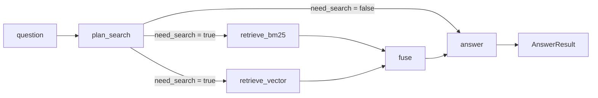
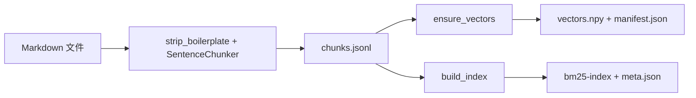

# 02 · 心智模型

> 代码基线：`dev@2d9604f`。
>
> 这篇不按文件讲，而是先建立一套能装下整个项目的概念框架。读完之后，你再看任何模块，都应该能把它放回正确的位置。

## 1. 一条主线

FastRag 的一次问答只有一条主线：



对应到代码，就是 `pipeline/nodes.py` 的五个节点和 `pipeline/graph.py` 的装配。

但在问答之前，还有一条建库流水线：



两条流水线的交汇点是 `chunks.jsonl`。**查询期只读 chunks 和派生产物，不再重新切块。**

把这两张图记住，后面所有模块都只是它们的展开。

## 2. 八个核心概念

### 2.1 Chunk：带身份证的文本片段

`domain.Chunk` 是不可变 dataclass：

```python
Chunk(
    id="a1b2c3d4e5f60718",
    source="data/langchain-docs/...md",
    start=123,
    end=456,
    text="...",
    token_count=210,
)
```

它同时承载三种信息：

| 信息 | 用途 |
| --- | --- |
| `id` | 内容寻址身份，向量复用与 BM25 回表的键 |
| `source/start/end` | 可追溯的原文位置，用于展示来源与校验切片 |
| `text/token_count` | 检索与回答的实际内容、token 预算参考 |

### 2.2 ChunkStore：唯一真源

`ChunkStore` 只做三件事：

1. 读取 `chunks.jsonl`；
2. 计算整个文件的 sha256 作为 `source_digest`；
3. 提供 `by_id` 映射。

它不关心向量、BM25、LLM。**所有派生产物都必须能通过 chunk id 回到它这里取正文。**

### 2.3 ScoredChunk：检索层的通用货币

```python
ScoredChunk(
    chunk=chunk,
    score=0.87,
    channel="vector",
    rank=1,
)
```

这是检索层与融合层之间**唯一**交换的类型。它明确表达：

- 命中的是哪个 chunk；
- 分数多少；
- 来自哪个通道（`bm25` / `vector` / `rrf` / `rerank`）；
- 在该通道里的名次。

不要在 `pipeline` 里传裸 dict，也不要把 LangChain `Document` 带出 `retrieve/rerank.py`。

### 2.4 ArtifactKey：派生产物的指纹

```python
ArtifactKey(
    kind="embeddings",
    source_digest="...",
    params={"model": "...", "dimensions": 2560, "normalized": True},
)
```

它回答一个问题：**这份派生文件是根据哪份 chunks、哪组参数生成的？**

- 向量 manifest 记录它，但加载时只校验模型/维度/形状；ids 对得上就复用；
- BM25 meta 记录它，加载时严格比较；不一致就要求重建。

### 2.5 SearchPlan：一次 LLM 路由的结果

```python
SearchPlan(
    need_search=True,
    bm25_query="human in the loop approval",
    vector_query="How does human-in-the-loop work?",
)
```

它把「要不要检索」和「用什么查询检索」合并成一次结构化输出。这样做的原因：

- 省一次 LLM 调用；
- 两路查询可以针对不同检索器优化（关键词 vs 自然语言）；
- 失败时有一个明确的降级点。

### 2.6 ResourceBundle：懒加载的资源包

流水线需要 store、embeddings、vectors、BM25、reranker、plan_chain、answer_chain、prompts。`ResourceBundle` 用 `cached_property` 把它们挂起来：

- `RagPipeline.__init__` 不读盘、不联网；`RagPipeline.from_config()` 会读 TOML，但不读 `.env`；
- 第一次真正用到某个资源时才加载；
- 同一个 pipeline 复用同一个 store/index/chain；
- `warmup()` 只预热索引类资源：`store`、`vectors`、`bm25`，`rerank` 模式下还会加载 `reranker`；它不加载 prompt、plan_chain、answer_chain。

这是「import 无副作用」和「一次加载、多次问答」的关键。

### 2.7 RagState：图里的状态

`RagState` 是 TypedDict，随着节点执行逐步填充：

| 字段 | 由谁写 | 含义 |
| --- | --- | --- |
| `question` | 入口 | 原始问题 |
| `plan` | `plan_search` | 路由结果 |
| `bm25` | `retrieve_bm25` | BM25 命中列表 |
| `vector` | `retrieve_vector` | 向量命中列表 |
| `fused` | `fuse` | 融合后的命中列表 |
| `answer` | `answer` | 回答文本 |

`AnswerResult` 不是状态字段，而是最后由 `result_from_state` 组装的对外结果。

### 2.8 Config：唯一开关

模型、检索、切块等可调参数集中在同一份 TOML：

- 用哪个端点、哪个模型；
- 切多大、重叠多少；
- 两路各召回多少、融合后留多少、进提示词多少；
- RRF 还是 rerank；
- 是否 thinking、重试几次、fallback 到谁。

但配置来源和运行环境仍受环境变量影响：`FASTRAG_HOME`、`FASTRAG_CONFIG`、`.env` 以及各端点的 key 环境变量都会改变实际行为。`extra="forbid"` 只保证模型里定义的键拼错时会在加载时暴露，不表示所有行为都由 TOML 单独决定。

## 3. 三种「身份」

这个项目大量使用「名字」来建立不变量。分清这几种身份，很多设计就顺了。

### 3.1 chunk id：内容身份

```text
id = sha1(source + "\0" + text)[:16]
```

- 文本变了 → id 变；
- 文件路径变了 → id 变（source 参与哈希）；
- 文件里其他位置变了、但这个片段没变 → id 不变；
- 同一个片段在不同文件里出现 → id 不同（source 不同）。

因此 id 可以安全地作为向量复用的键：在目标规模下，**id 相同可视为文本相同**。严格来说 id 是 `sha1` 的 64 位截断，碰撞概率可忽略；若要求数学上的绝对保证，需要保存完整哈希或额外比较 `text`。

### 3.2 ArtifactKey：派生身份

```text
(kind, source_digest, params)
```

- `kind`：`embeddings` / `bm25`；
- `source_digest`：整个 `chunks.jsonl` 的 sha256；
- `params`：影响该产物的配置（模型、维度、method、stopwords...）。

它回答「这份产物是否对应当前语料与参数」。注意向量和 BM25 对它的使用强度不同：

- 向量：manifest 里有，但复用主要看 ids；
- BM25：加载前严格比较，不匹配直接拒绝。

### 3.3 channel：来源身份

检索结果必须带通道名：

- `bm25`
- `vector`
- `rrf`
- `rerank`

融合权重按通道名索引，CLI 也按通道名打印名次。新增通道时，主要改动是索引层检索函数、`RagState`、节点与图边，以及 CLI `rrf` 的 rankings 组装；`Fusion` 的 weights 校验允许 `bm25`/`vector` 之外的键，展示格式也未必需要改。

## 4. 三套「坐标」

这是最容易读错的地方。

### 4.1 字符偏移：`start` / `end`

- 单位是 Python 字符串下标（字符，不是字节）；
- 指向源文件（剥离模板头之后的正文，偏移已加回）；
- 用于展示来源、校验 `text == original[start:end]`。

### 4.2 token 计数：`token_count` / `chunk_size` / `overlap`

- 切块大小和重叠按 tiktoken token 计；
- `token_count` 是该 chunk 的 token 数；
- 它**不是**字符长度，也不保证与嵌入模型的分词器完全一致；
- 回答阶段的 `context_chunks` 限制的是「条数」，不是 token 预算。

### 4.3 排名与分数

| 通道 | 分数含义 | 范围 |
| --- | --- | --- |
| BM25 | bm25s 的相关性分 | 无固定上界，通常 >0 |
| vector | 归一化向量的内积（余弦相似度） | 约 [-1, 1] |
| RRF | `Σ weight / (k + rank)` | 正数，取决于名次与权重 |
| rerank | 重排服务返回的 relevance score | 由服务定义，通常 [0,1] |

**不同通道的分数不可直接比较。** 这正是 RRF 只用名次、不用原始分数的原因。rerank 也只在合并后的候选集内部排序。

## 5. 不变量清单

下面这些是项目的「物理定律」。改代码前先确认不会破坏它们。

| # | 不变量 | 在哪里保证 | 破坏了会怎样 |
| --- | --- | --- | --- |
| 1 | `chunks.jsonl` 是唯一真源 | `ChunkStore`、所有检索回表 | 向量/BM25 与正文错位 |
| 2 | `text == original[start:end]` | `chunker.build_chunks` 加回模板头偏移 | 来源链接/引用位置错误 |
| 3 | chunk id 内容寻址 | `chunker.chunk_id` | 向量复用错位、缓存污染 |
| 4 | 派生产物带来源指纹 | `ArtifactKey` / manifest / meta | 改了语料却仍用旧索引 |
| 5 | 向量行顺序与 ids 一致 | `ensure_vectors` 写 npy + manifest | 检索到错误的 chunk |
| 6 | 检索层只交换 ScoredChunk | `domain` / `index` / `retrieve` | 类型混乱、通道信息丢失 |
| 7 | 配置加载即校验 | pydantic `extra="forbid"` + validator | 拼写错误静默生效 |
| 8 | import 与 `RagPipeline.__init__` 无 I/O | `ResourceBundle` 的 `cached_property` | 测试/嵌入场景出现意外网络/磁盘访问 |
| 9 | 外部服务失败（路由/重排/回答）就地降级；检索/索引错误必须暴露 | 路由/重排/回答的 try-except，检索节点不捕获 | 单点故障拖垮整次问答，或把索引损坏伪装成「无结果」 |
| 10 | 单文件产物原子写 | 临时文件 + `os.replace`；BM25 目录由 `bm25s.save` 直接写，不在保证范围内 | 进程中断留下半截 JSON/npy 文件 |

## 6. 两条时间线

### 6.1 建库期（`download` + `prepare`）

`download` 是独立的前置命令，不属于 `prepare`；`prepare` 从读取已有 Markdown 开始。

```text
download（独立命令）
  → Markdown 文件
prepare
  → iter_docs / strip_boilerplate
  → SentenceChunker
  → chunk_id + chunks.jsonl
  → ensure_vectors（增量复用 / 补嵌 / 全量重建）
  → build_index（BM25 全量重建）
```

建库期的核心任务是**把不可靠的外部文档变成可校验的本地产物**。所有昂贵操作（嵌入、BM25 训练）都在 `prepare` 里发生；目录为空时它会提示先运行 `fastrag download`。

### 6.2 查询期（`ask` / `stream`）

```text
question
  → plan_search（LLM 结构化输出）
  → retrieve_bm25 / retrieve_vector（并行）
  → fuse（RRF 或 rerank）
  → answer（拼 context + LLM）
  → AnswerResult / AnswerEvent
```

查询期原则上只读产物，但有一个懒加载副作用：第一次访问 `ResourceBundle.vectors` 时会调用 `ensure_vectors`。它分三种情况：

- **没有可复用旧向量**（缺 manifest/npy，或模型/维度不符）：全量嵌入当前所有 chunk，并写回矩阵与 manifest；
- **旧 ids 与当前 ids 完全相同**（含顺序）：直接复用旧矩阵，不写盘、不调用嵌入；
- **旧 ids 不同**：复用仍存在的 id，只对缺失 id 调用嵌入；如果只是顺序变化，则只重写矩阵与 manifest，不调用嵌入。

所以“ids 对不上”不等于“一定重新嵌入”；第一次 `ask` 变慢通常发生在需要补嵌或没有旧向量的时候。

## 7. 状态机与降级

`graph.py` 的边很少，但 `nodes.py` 里的降级分支不少。把「正常路径」和「降级路径」分开看：

### 7.1 正常路径

| 条件 | 下一步 |
| --- | --- |
| `need_search = true` | 并行进入 `retrieve_bm25` 与 `retrieve_vector` |
| `need_search = false` | 直接进入 `answer`，使用 chat 提示词 |
| 两路召回完成 | 进入 `fuse` |
| 融合完成 | 进入 `answer` |

### 7.2 降级路径

| 故障 | 行为 | 结果 |
| --- | --- | --- |
| 路由 LLM 异常 / 空结果 | `_degrade_route`：`need_search=True`，两路查询都用原问题 | 仍然尝试检索 |
| `need_search=true` 但某一路查询为空 | 该路回退为原问题 | 不会用空字符串检索 |
| 两路都空 | `fuse` 返回 `[]` | 回答阶段拿到「无检索结果」 |
| rerank 初始化/调用异常 | 记录 warning，改用 RRF | 仍有融合结果 |
| 回答模型异常 / 空回答 | `_answer_text` 捕获后返回空串；chain 的 fallback / 空回答检测会尝试备用模型 | 可能得到备用模型回答 |
| 单轮 CLI 异常 | `ask` 循环捕获并打印，不退出 | 可以继续问下一题 |

注意几个边界：

- 路由失败不是「不检索」，而是「用原问题检索」；
- 重排失败不是「返回空」，而是「退回 RRF」；
- 回答失败不是「抛给用户」，而是「尽量走 fallback，仍失败则空回答」；
- 检索本身抛异常（例如 BM25 索引损坏）不会被节点吞掉，会一路抛到 CLI/调用方。

## 8. 配置如何改变心智模型

同一套代码，换个配置就是另一种系统。重点理解这几个开关：

### 8.1 `fusion.method`

```toml
[fusion]
method = "rrf"   # 或 "rerank"
```

- `rrf`：不初始化 reranker；两路结果按名次融合；
- `rerank`：初始化 reranker；先合并两路候选并按 id 去重，再整体重排；
- `rerank` 失败 → 自动退回 RRF。

### 8.2 `top_n` vs `context_chunks`

```toml
[retrieval]
top_n = 5
context_chunks = 5
```

- `top_n`：融合后保留多少条，也是 CLI 默认输出条数；
- `context_chunks`：回答提示词里放多少条的**上限**；实际条数是 `min(context_chunks, top_n)`；
- `AnswerResult.sources` 是 `fuse` 产出的全部 `fused`（最多 `top_n` 条），不是只放进了提示词的那几条。

如果 `context_chunks < top_n`，用户看到的来源可能比模型实际读到的多。这是有意的：来源用于展示与追溯，上下文用于控制成本。反过来，把 `context_chunks` 设得比 `top_n` 大不会扩大上下文，因为候选在 `fuse` 阶段已经被截断。

### 8.3 `thinking`

```toml
[llm.answer]
thinking = false
```

- `false`：通过 `extra_body.setdefault("enable_thinking", False)` 注入；如果 `extra_body` 已经显式设置 `enable_thinking`，以 `extra_body` 为准；
- `true`：不注入这个字段，使用服务端默认行为（除非 `extra_body` 自己设置了 `enable_thinking`）。

它不是「强制开启思考」，只是控制是否注入关闭开关。不同 provider 对默认值的解释可能不同。

### 8.4 `api_key_env`

```toml
[endpoints.local]
base_url = "http://127.0.0.1:9938/v1"
api_key_env = ""
```

空字符串表示本地服务，`endpoint_api_key` 返回占位 key `local`，不会去环境变量里找空名字。云端端点则必须在 `.env` 或进程环境里提供对应变量。

### 8.5 `--config` 的路径优先

`--config local` 的名字解析有一个容易忽略的细节：**先当文件路径找，找不到才当包内资源名。** 如果当前目录恰好有一个叫 `local` 的文件，它会覆盖包内的 `fastrag.local.toml`。

## 9. 常见误解

### 9.1 「top_n 就是给模型的上下文条数」

不对。`top_n` 是排名截断，`context_chunks` 控制进入提示词的条数上限；实际是 `min(context_chunks, top_n)`。两者默认都是 5，所以容易混淆。

### 9.2 「向量 manifest 的 digest 不匹配就一定要重嵌」

不一定。`_load_previous` 只校验模型/维度/形状；只要旧 ids 与新 chunks 的 ids 能对上，就按 id 复用。digest 变化但文本没变的块，向量仍然有效。

### 9.3 「BM25 也可以按 id 增量」

当前不行。`build_index` 每次全量 tokenize + index；`prepare` 即使语料没变也会重建 BM25。语料变化后 BM25 必须重建，不能只补新增块。

### 9.4 「重排失败会报错」

不会。`fuse` 捕获异常后降级 RRF，只记录 warning。对调用方来说，结果仍然可用，只是 `channel` 从 `rerank` 变成 `rrf`。

### 9.5 「路由失败会直接不检索」

不会。路由失败时 `_degrade_route` 把 `need_search` 设为 true，两路查询都用原问题。系统宁可多检一次，也不愿因为路由故障直接放弃资料。

### 9.6 「RRF 会用 ScoredChunk.rank」

不会。`rrf_fuse` 对传入列表做 `enumerate`，名次来自列表顺序，`ScoredChunk.rank` 在该函数里不参与计算。上游 `search_bm25` / `search_dense` 返回的顺序已经是排名顺序，所以正常路径一致；但如果你手动打乱列表，RRF 会按新顺序算。

### 9.7 「`fastrag ask` 会记住上一轮」

不会。交互循环每次调用 `pipeline.stream(question)`，不把历史塞进 state。它是「连续单轮」，不是多轮对话。

### 9.8 「`RagPipeline.from_config()` 会自动读 .env」

不会。只有 CLI 和模块级 `ask()/stream()` 调用了 `load_env()`。直接用 `RagPipeline` 时，云端 key 需要你自己先加载。

### 9.9 「BM25 和向量分数可以比较」

不可以。一个是 bm25s 的相关性分，一个是余弦相似度，量纲和分布都不同。融合层要么只用名次（RRF），要么用重排模型统一打分（rerank）。

### 9.10 「`prepare` 只处理新增文档」

不是。`prepare` 每次都重新切全部文档并重写 `chunks.jsonl`，再重建 BM25；只有向量嵌入是按 id 增量的。

## 10. 一张图总结

```text
                    ┌──────────────────────────────┐
                    │        chunks.jsonl          │
                    │  id = hash(source + text)    │
                    │  text == original[start:end] │
                    └──────────────┬───────────────┘
                                   │
                 ┌─────────────────┴─────────────────┐
                 │                                   │
        ┌────────▼────────┐                 ┌────────▼────────┐
        │   vectors.npy   │                 │   bm25-index    │
        │  + manifest     │                 │   + meta.json   │
        │ 按 id 复用/补嵌 │                 │  严格校验指纹   │
        └────────┬────────┘                 └────────┬────────┘
                 │                                   │
                 └──────────────┬────────────────────┘
                                │
                         query time
                                │
        question → SearchPlan ──┼──→ bm25 hits / vector hits
                                │           │
                                │        fuse (RRF/rerank)
                                │           │
                                │        top_n + context_chunks
                                │           │
                                └──────→ answer → AnswerResult
```

## 11. 自测：能回答这十个问题就说明掌握了

1. 为什么 chunk id 要把 `source` 放进哈希？
2. 为什么向量复用不比较 `source_digest`，BM25 却要比较？
3. `top_n` 和 `context_chunks` 分别控制什么？
4. 路由失败时，两路查询用什么？
5. 重排失败时，`fused` 里的 `channel` 是什么？
6. 为什么 `AnswerResult.sources` 可能多于模型实际读到的片段？
7. 第一次 `ask` 为什么可能触发写盘和嵌入调用？
8. RRF 的 `rank` 来自哪里？`ScoredChunk.rank` 在 RRF 里有用吗？
9. `--config local` 的查找顺序是什么？
10. `text == original[start:end]` 里的 `original` 是原文还是剥离模板头后的正文？偏移是怎么补回来的？

如果其中任何一题答不上来，回到对应小节，或者直接去 03 篇看代码路径。
